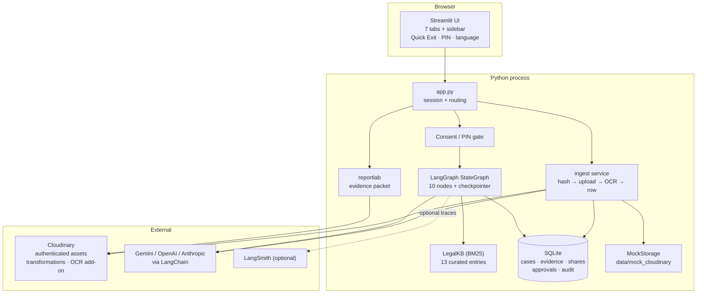
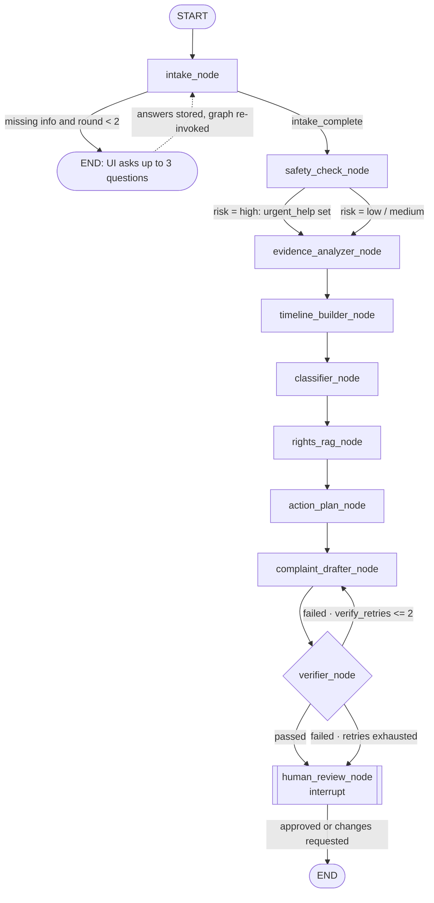
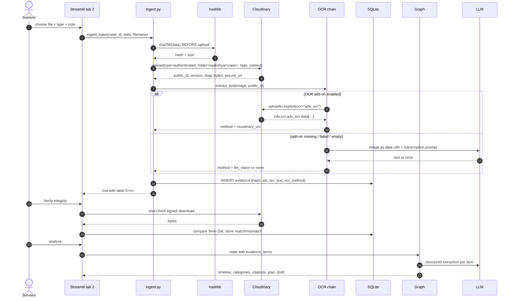

# Architecture

Saakshya is a single Streamlit process, a SQLite database, a compiled LangGraph state machine and Cloudinary as the
only place where evidence bytes live. This document explains how the pieces fit, what was deliberately left out, and
what could go wrong for the person using it.

---

## 1. System overview



Key boundaries:

- **Bytes never live in SQLite.** The database stores metadata, hashes and Cloudinary ids only.
- **Every external call is optional.** Missing key, missing add-on, network failure or mock mode all produce a usable
  screen (see §7).
- **The UI never talks to Cloudinary directly for uploads.** `src/ingest.py` owns the order of operations so the hash
  cannot be skipped.

---

## 2. The LangGraph pipeline



**State** (`src/graph/state.py`) is a `TypedDict` with `case_id`, `user_story`, `language`, `evidence_items`,
`timeline`, `issue_categories`, `risk_level`, `legal_matches`, `action_plan`, `complaint_draft`, `human_approved`,
`errors` (reducer `operator.add`) and stage counters. Nodes return partial updates; LangGraph merges them.

**Checkpointing.** `InMemorySaver` by default; `SqliteSaver` when `CHECKPOINT_BACKEND=sqlite`. The `interrupt()` in
`human_review_node` only works because the thread is checkpointed: the first `invoke` stops inside the node, the UI
shows the draft, and `Command(resume={...})` continues on the same `thread_id` (`<case_id>:<run_index>`).

**Follow-up loop.** The rhetorical version of this graph has an edge from `intake` back to itself. Implemented
literally, a survivor would be asked question after question inside one run, with no way to stop. Instead the node
sets `followup_questions` and routes to `END`; the UI collects answers, stores them on the case, and re-invokes the
graph with `followup_round = MAX_FOLLOWUP_ROUNDS`. It is still a conditional edge with a bounded loop (one round of up
to three questions), but the pause lives in the UI where she can leave.

**Verifier loop.** `verify()` checks (a) at least one `[KB-xx]` citation, (b) every cited id exists in
`legal_matches`, (c) every ISO date in the draft appears in the input corpus. On failure `verify_retries` increments
and the conditional edge sends the draft back with the problems as feedback; after two retries the draft is shown with
a visible "flagged" warning instead of pretending it passed.

All nodes are wrapped in `@safe_node`, which records `errors`/`stage` instead of raising. One exception is re-raised on
purpose: `GraphBubbleUp` (the LangGraph interrupt signal) so the approval pause can never be swallowed by the guard.

---

## 3. Upload → integrity → OCR → analysis (sequence)



---

## 4. Data model (SQLite)

```
cases
  id TEXT PK              case_ab12cd34ef
  title, user_story       her own words (never logged)
  language                en | hi
  risk_level              low | medium | high
  issue_categories        JSON [{category, confidence}]
  followup_answers        JSON [str]
  timeline, timeline_gaps JSON
  action_plan             JSON [{priority, title, detail, contact}]
  legal_matches           JSON [{kb_id, title, act, citation, …}]
  draft_text              latest draft (approved text after approval)
  verifier_status         passed | flagged
  human_approved INTEGER  0/1  ← export gate
  approver                optional name she typed
  is_demo, consent_accepted INTEGER
  created_at, updated_at  ISO-8601 UTC

evidence
  id TEXT PK              ev_…
  case_id FK → cases      ON DELETE CASCADE
  label                   E1, E2, …
  filename, evidence_type screenshot | photo | audio | video | document | other
  resource_type           image | video | raw   (Cloudinary's answer)
  public_id, secure_url, version, format, num_bytes, etag
  sha256                  64-char hex, computed before upload
  uploaded_at             ISO-8601 UTC
  ocr_text, ocr_method    cloudinary_ocr | llm_vision | text_file | none
  transcript              her own note/description for audio or video
  thumbnail_url           signed transformation URL
  tags, context           JSON of Cloudinary tags/context (case_id, type, uploaded_at)
  integrity_status        unverified | match | mismatch | error
  integrity_checked_at

share_links
  id, case_id, evidence_id (nullable), kind (asset | redacted | packet)
  url                     signed, expiring
  transformations         free text describing what was applied
  expires_at, created_at, revoked

approvals                    append-only: every approval is kept
  id, case_id, draft_text, approver, verifier_status, approved_at

app_settings                 app_pin_hash (salt$pbkdf2), consent_accepted
audit_log                    id, case_id, action, detail, created_at
```

Notes:

- `evidence` rows are the integrity record: hash + Cloudinary ids + verification status live together.
- `share_links` is the audit trail of everything that left the app, so links can be reviewed and revoked.
- `audit_log.detail` holds labels such as `E3:match` - never story or OCR content.
- The JSON columns keep the schema simple for a hackathon; a production schema would normalise timeline and citations.

---

## 5. Cloudinary asset strategy

| Concern | Decision |
| --- | --- |
| Folder layout | `saakshya/<case_id>/<original-stem>_<short-random>.<ext>` - one folder per case so deleting a case is one prefix delete |
| Access type | `type="authenticated"` for every upload; nothing is publicly deliverable |
| Resource types | `resource_type="auto"` on upload; audio lands as `video` in Cloudinary, which is why the UI checks `format` before choosing an audio player |
| Metadata | `tags`: `saakshya`, `<case_id>`, `<evidence_type>`, `redacted` (copies). `context`: `case_id`, `evidence_type`, `uploaded_at`, `derived_from` |
| Versioning | `version` and `etag` stored next to the hash; a re-upload creates a new asset rather than overwriting (`overwrite=False`) |
| Viewing | Signed download URL (`private_download_url`) with a short lifetime for verification; signed transformation URLs for thumbnails inside the app |
| Sharing | `private_download_url` with `expires_at = now + 1h/24h/7d`; the UI shows the lifetime and the share list shows a countdown |
| Redaction | `e_blur_faces:1200`, plus an optional region: overlay the same asset (`l_`), crop it to the rectangle (`c_crop,w,h,x,y`), blur it (`e_blur:900`), and apply it back (`fl_layer_apply`) at the same coordinates |
| Expiring redaction | Render once, store as a new authenticated asset tagged `redacted`, share that with `private_download_url`. A transformation URL alone cannot carry an expiry without an auth-token key |
| Gallery | `w_480,h_360,c_fill,q_auto,f_auto` for images; `so_0,w_480,h_360,c_fill` for video posters |
| OCR | `uploader.explicit(public_id, type="authenticated", ocr="adv_ocr")`, response parsed defensively (`textAnnotations`, `fullTextAnnotation`, `info.ocr.text`) |
| Deletion | `destroy(type="authenticated", invalidate=True)` per asset, `delete_resources_by_prefix("saakshya/<case_id>/")` per case, `delete_resources_by_prefix("<public_id>_redacted")` for derived copies |
| Failure handling | Every SDK call is wrapped; `StorageError` carries a human-readable message that the UI shows without a traceback |

---

## 6. Security and threat model

The person using Saakshya may be sharing a phone with the person harming her. The design assumes the device is hostile
until proven otherwise.

| # | Threat | Scenario | Mitigation in this build | Residual risk |
| --- | --- | --- | --- | --- |
| T1 | **Device sharing** | Partner picks up the phone and opens the browser | Optional PIN (PBKDF2-SHA256, 200k iterations, random salt, stored as `salt$hash`); Quick Exit clears session and redirects to a weather page; minimal on-screen text | A shared device can still show the app before the PIN is set; browser history/recents may show the URL |
| T2 | **Link leakage** | A signed link is forwarded or posted in a group | Links expire in 1h/24h/7d, are scoped to one asset, are listed in an audit trail, and can be revoked; redacted copies are separate assets | Anyone with a live link can download until it expires - no recipient authentication |
| T3 | **Abuser access** | He knows her Cloudinary account or the laptop | Credentials only in `.env`; private assets; no credentials in the UI or logs; delete-everything removes remote folders | If he controls her email/account, he can reset access - out of scope |
| T4 | **LLM data exposure** | Story text and OCR text are sent to Gemini/OpenAI/Anthropic | Provider is switchable via env; tracing off by default; prompts contain only the story/evidence text needed; no keys logged; `DEMO_MODE`/`LLM_ENABLED=false` keeps everything local | Third-party retention/training policies apply; the app cannot guarantee deletion at the provider |
| T5 | **Local database** | Someone copies `data/saakshya.db` | The DB is local and git-ignored; only metadata and hashes are stored, never bytes | It is **not encrypted**; full-disk encryption and a device she controls are assumed |
| T6 | **Logs and screenshots** | Story text ends up in a log file or a demo screenshot | Logging policy: action names, labels, counts, error types only; no story/OCR/draft text; demo data is synthetic | Streamlit/uvicorn access logs still record requests; screen recording during a demo is on the presenter |
| T7 | **Credential leakage** | `.env` committed or pasted into a chat | `.env` in `.gitignore`; `.env.example` has no secrets; `Settings.describe()` returns booleans only | A leaked key must be rotated manually in the Cloudinary/Google console |
| T8 | **Malicious upload** | A file crafted to attack the app or the viewer | Files are stored as opaque bytes; type detection is by extension; Pillow opens images inside `try/except` | No antivirus scanning - only her own files should be uploaded |
| T9 | **Coercion** | He demands to see the phone and the app | Quick Exit, delete-everything, per-item delete, no visible "evidence" wording on the neutral redirect | Cannot protect against coercion; the UI never promises it can |
| T10 | **Re-identification in a "redacted" copy** | Background details, tattoos or a name survive the blur | `e_blur_faces` plus an optional user-drawn region; the UI tells her to check the preview before sharing | Face detection can miss a face; metadata (EXIF/GPS) is not stripped in this build |
| T11 | **Harm from the tool itself** | Repeated questions, a fake "you have a case" promise, legal text read as advice | Follow-ups capped at three, once; every rights entry cites a source and says "verify with a lawyer"; disclaimers on the app, the plan, the draft and the PDF | Emotional safety needs human research and review |
| T12 | **Wrong legal claim** | A section number changes or is misremembered | Curated KB only, `last_reviewed`, `verify_with_lawyer` enforced by the loader, uncertain BNS/BNSS numbers explicitly flagged rather than guessed; verifier blocks uncited claims | The KB is team-curated, not lawyer-certified |

Additional controls: `human_approved` is required before the PDF can be built; `approvals` is append-only; `share_links`
and `audit_log` make "what left the device" reviewable.

---

## 7. Graceful degradation

| Failure | Behaviour |
| --- | --- |
| No LLM key / `LLM_ENABLED=false` / `DEMO_MODE=true` | Every node falls back to `src/graph/deterministic.py`; the sidebar says `offline templates` |
| LLM call fails or returns invalid JSON | `invoke_structured` returns `None`; the node uses its heuristic/template; the failure is logged by type only |
| OCR add-on unavailable / disabled / empty | Log line, then vision LLM, then `ocr_method="none"` with a UI badge; evidence is still stored and hashed |
| Vision LLM unavailable | `none`, with a note that the text could not be extracted |
| Cloudinary not configured | `StorageError` with a setup message; the vault shows the error, the rest of the app still renders |
| `USE_MOCK_CLOUDINARY=true` | `MockStorage`: local files, HMAC-signed `mock://` URLs with real expiry checks, Pillow thumbnails and local blur |
| PDF thumbnail fetch fails | A placeholder caption replaces the image; the packet still builds |
| Node raises unexpectedly | `@safe_node` records the error, sets a stage, routing continues; the node list shows the errors |
| SQLite checkpointer unavailable | Warns and falls back to memory |

---

## 8. Design decisions and trade-offs

### D1 · Streamlit instead of React + FastAPI
**Alternatives:** Next.js + FastAPI, Flask + Jinja, Gradio.
**Why Streamlit:** one language, no build step, `st.tabs`/`st.status` give a demo-ready UI in hours. A two-person team in
a 48-hour hackathon cannot maintain an SPA plus an API plus an agent service.
**Cost:** rerun-based state, no real routing, weak auth, and `st.components.v1.html` (used for Quick Exit) is a
deprecating API. Accepted for a prototype; the pipeline and storage layers are UI-independent, so a React client can
replace `app.py` without touching `src/graph` or `src/ingest`.

### D2 · Authenticated assets, not public URLs + signature
**Alternatives:** public uploads with `sign_url`, "private" type, or an external bucket.
**Why:** `type="authenticated"` means there is no publicly guessable delivery URL at all. A leaked `public_id` is not
enough. Cloudinary's `private_download_url` then adds an explicit expiry, which is exactly the sharing primitive a
lawyer/NGO hand-off needs.
**Cost:** every read (thumbnail, integrity check, PDF) needs a signed URL; the app must be online to verify.

### D3 · Human-in-the-loop as a hard gate
**Alternatives:** auto-generate and let her download, or approve at the end of the UI flow.
**Why an `interrupt()`:** the requirement is that nothing is exported without approval, and a graph-level pause is
auditable (the checkpoint holds the pending state). It also lets the UI treat "awaiting approval" as a first-class
state instead of a hidden boolean.
**Cost:** needs a checkpointer; an in-memory checkpointer loses the pause on a process restart (`CHECKPOINT_BACKEND=sqlite`
fixes that).

### D4 · Curated KB instead of RAG over the open web
**Alternatives:** scrape India Code, search the web live, fine-tune a model.
**Why:** a hackathon cannot guarantee legal accuracy at web scale, and a wrong section number can hurt a real
complainant. 13 hand-written entries with a source URL, a review date and a "verify with a lawyer" flag are defensible
and auditable; the verifier can then enforce that every claim cites one.
**Cost:** limited coverage, and the KB is only as good as its review. The roadmap adds a lawyer review workflow.

### D5 · BM25 instead of embeddings / Chroma / FAISS
**Alternatives:** Chroma with Gemini embeddings, FAISS with `text-embedding-3-small`, hybrid.
**Why:** the corpus is 13 documents. Exact legal terms ("zero FIR", "s.66E", "POSH IC") are better served by keyword
scoring, and BM25 needs no key, no model download and no vector store, which keeps the demo deterministic and offline.
**Cost:** no semantic recall for paraphrases. `LegalKB.search` is a single method - swapping in a vector store is a
contained change, and the citation contract stays identical.

### D6 · Hash on the device before upload
**Alternatives:** trust Cloudinary's `etag`, or hash after download.
**Why:** the point is to prove *what she uploaded*, at *the moment she uploaded it*. The local SHA-256 is stored next to
the Cloudinary ids, so a later re-download proves the bytes did not change. Cloudinary's md5 `etag` is kept as a
secondary signal (and compared during verification).
**Cost:** hashing large videos takes time; it happens in memory/file before upload with a 1 MiB chunked read.

### D7 · Redacted share = derived asset + expiring download
**Alternatives:** share the transformation URL directly (simpler), enable auth tokens (needs an account-level hex token
key), or pre-generate redacted assets at upload time (storage cost, and she may never need them).
**Why:** a signed transformation URL does not expire, and `private_download_url` cannot apply transformations. Creating
the blurred copy once and sharing it with an expiring link satisfies both "privacy-safe copy" and "share links must
expire", and the copy can be deleted independently.
**Cost:** extra storage and an extra Cloudinary call; derived copies are cleaned up when the evidence or case is deleted.

### D8 · MemorySaver by default, SqliteSaver optional
**Why:** memory keeps the demo setup to zero configuration and avoids SQLite lock issues on Windows. `sqlite` is one env
variable away and is the right choice if the app must survive a restart between review and approval.
**Cost:** two code paths to keep correct; both are exercised by the same graph.

### D9 · One bounded round of follow-up questions
**Alternatives:** loop until all four fields are present.
**Why:** repeated questioning is a known harm in trauma-informed design, and a survivor may not know exact dates. The
intake node asks once (up to three questions), then proceeds with gaps explicitly flagged in the timeline.
**Cost:** some drafts will be vaguer on dates; the gaps list makes that visible instead of invented.

### D10 · Mock storage as a first-class backend
**Why:** tests, offline demos and reviewers without a Cloudinary account. The mock implements the same `Storage`
protocol, signs URLs with HMAC (so expiry can be tested), and applies a real Pillow blur for redacted previews.
**Cost:** it cannot prove Cloudinary's CDN behaviour; `storage_status()` and a UI pill make the mode obvious.

### D11 · SQLite instead of Postgres
**Why:** single user, single device, zero setup, easy "delete everything". Columns that hold lists are JSON because the
schema is stable enough for a prototype and changing it is cheap.
**Cost:** no concurrent writers, no row-level security, no encryption at rest.

### D12 · Deterministic templates next to every LLM step
**Why:** a demo that fails when a free-tier quota runs out is not a demo. Templates guarantee the same *shape* of output
(timeline, cited matches, plan, draft with hashes), so the UI and the PDF never depend on model availability.
**Cost:** more code to maintain, and the offline draft is more formulaic. The UI says which brain was used.

---

## 9. Scalability notes

- **Storage.** Per-case folders keep deletes O(1). At NGO scale, add a per-organisation root prefix and a mapping table;
  Cloudinary's folder API and `delete_resources_by_prefix` still apply.
- **Database.** SQLite is fine for one user. For multi-user: Postgres with row-level security, `cases.owner_id`,
  encrypted columns for narrative text, and a separate table for timeline/citations instead of JSON blobs.
- **Graph.** Compilation is cached per process; the graph is stateless apart from the checkpointer. Horizontal scaling
  needs a shared checkpointer (Postgres/Redis) and a sticky or stateless UI (the thread id already identifies the run).
- **LLM cost.** Per case the pipeline makes: one structured call per evidence item, one classifier call, one plan call,
  one draft call, plus up to two retries, plus OCR fallback calls. With 10 items that is roughly 15 calls - a
  free-tier-friendly budget. Batching evidence analysis would cut it further.
- **PDF.** Built synchronously; a 20-item packet with thumbnails takes a few seconds. Move to a worker (Celery/RQ) if
  packets grow or thumbnails are large.
- **Legal KB.** 13 entries fit in memory. At 500+ entries, keep BM25 (fast, no embeddings) or add a hybrid retriever;
  either way, keep the citation contract and the review metadata.
- **Rate limits.** Cloudinary upload/admin calls and LLM calls should be queued and retried with backoff in production;
  the prototype shows a friendly error instead.
- **Observability.** LangSmith gives node traces (off by default to protect privacy). Add metadata-only metrics:
  uploads, integrity checks, approvals, deletes, errors by type - never content.

---

## 10. Repository map

```
app.py                     Streamlit entry point, sidebar, gates, tabs
src/config.py              env-driven settings, logging, safe describe()
src/llm.py                 provider-agnostic chat models + structured output
src/db.py                  SQLite schema and queries
src/integrity.py           SHA-256 hashing and comparison
src/cloudinary_client.py   real Cloudinary + offline mock, signing, redaction, deletes
src/ocr.py                 OCR chain with method badges
src/ingest.py              hash → upload → OCR → DB, verify, delete
src/rag.py                 BM25 retrieval, citations
src/graph/state.py         typed state + Pydantic schemas
src/graph/deterministic.py heuristics + bilingual templates
src/graph/nodes.py         the ten nodes, routing helpers
src/graph/build.py         graph wiring, checkpointer, streaming, mermaid
src/pdf_export.py          reportlab evidence packet
src/i18n.py                English / Hindi UI strings
src/samples.py             synthetic demo files and demo case
src/ui/styles.py           theme
src/ui/components.py       safety banner, PIN, badges, previews
src/ui/state.py            session/DB glue for runs
src/ui/tabs.py             the seven tabs
data/legal_kb/*.json       curated legal KB (4 files, 13 entries)
data/samples/              generated synthetic evidence
tests/                     integrity, Cloudinary URLs, RAG, graph routing, PDF
```
